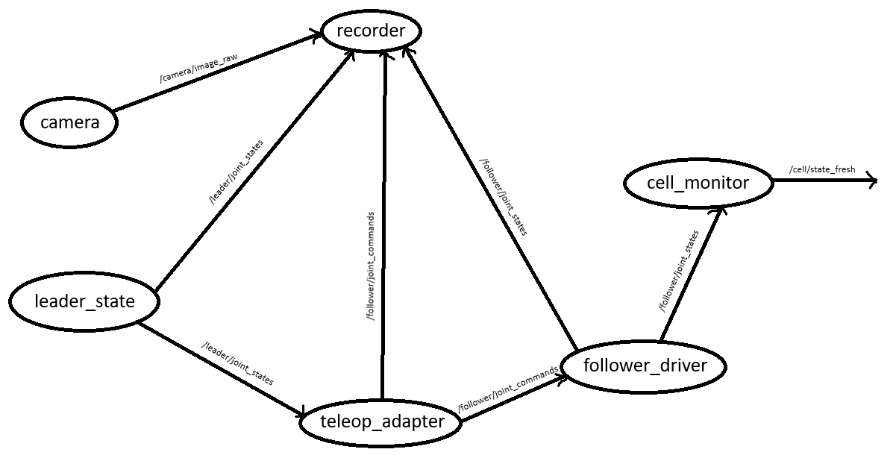

# Summary of the work done

## Tasks 1-5

The script `analyze_episodes.py` is responsible for performing an analysis on a given CSV file containing episode data. This analysis counts the number of sessions, reports on their overall usability overall and per session, and counts the number of successful sessions among the usable entries. Additionally, it filters out any 'usable' entries with suspicious data, such as missing values, or having its duration be <= 0. 

To run it, use the following command in the terminal:
```sh
python3 analyze_episodes.py [file_name]
```

Many input errors were covered in the script. Passing a non-existant file or a file of a different extension will output a message without displaying Python's native error messages to the user. 

Additionally, the script `unit_tests.py` presents various unit tests to the `flag_recording` function of `analyze_episodes.py`. The following cases are tested:

* A usable and successful entry;
* A usable and failed entry;
* A unusable entry;
* A usable entry with invalid frames;
* A usable entry with invalid duration;
* A usable entry with null values.

To run it, use the following command in the terminal:

```sh
python3 unit_tests.py
```
----------------

## Task 6

A leader/follower arm setup is one where the leader arm, controlled by a human, performs a task to be replicated by the follower arm. One such task could be, for instance, putting a cube inside a bin. 
Observation is usually performed by the arm sensors, as well as cameras recording the task. The observed movement of the leader is treated as a target for the follower to achieve.
The joint state of each joint can be understood as the current position, velocity or torque of that joint. They are usually limited by actuator limits - safety or hardware constraints that limit the movement of a joint. If a robot displays hazardous movement, it can usually be stopped through an emergency stop button.

-------------

## Task 7



In this snapshot, the current `check_time_ms` is $2000ms$. The latest `last_follower_joint_state_received_ms` received was recorded at $1300ms$, thus, it has an age of $700ms$. This exceeds the stale threshold of $500ms$, ensuring `/cell/state_fresh` is false. Despite receiving commands, the robot does not necessarily move, for example, if its commanded to make movement beyond its actuator limits.

----

## Tasks 8-10

The implementation of `is_stale()` and `on_state()` were implemented in their respective files. The implementation works as expected, with the correct `/cell/state_fresh` value changes.

-----